# Animation gallery

[Back to README](../README.md) · [API reaction reference](api.md#reaction-summary) · [Artwork and attribution](artwork.md)

All 64 reactions, rendered by the native display renderer. Categories, order and labels match the local preview; every category uses three columns. The example clock and connected Wi-Fi icon are fixed for reproducible exports; retro Windows scenes omit the clock and show a single delayed peek in each 10-second sample. Their user-provided backgrounds are visual only, never an actual crash or shutdown.

Choose [Finished](#finished) for waving, dancing or chilling after work; these are existing actions regrouped for discovery, not a new API mode. Their claude.dev source credits remain in the [reaction reference](api.md#reaction-summary). [Easter Eggs](#easter-eggs) includes both the [Windows blue-screen GIF](gallery/windows_bsod.gif) and [Windows shutdown GIF](gallery/windows_shutdown.gif).

<!-- BEGIN ANIMATION GALLERY -->
## Everyday & custom

<table>
  <tr>
    <td align="center" width="33%"><strong>Rest</strong> <code>idle</code> 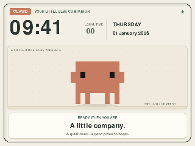</td>
    <td align="center" width="33%"><strong>Smile</strong> <code>smile</code> 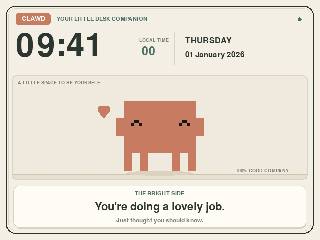</td>
    <td align="center" width="33%"><strong>Knock on screen</strong> <code>knock</code> 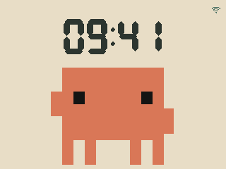</td>
  </tr>
  <tr>
    <td align="center" width="33%"><strong>Wait</strong> <code>waiting</code> 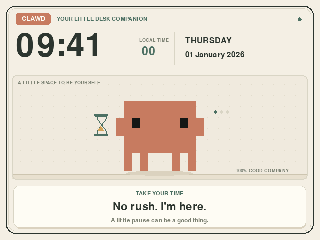</td>
    <td align="center" width="33%"><strong>Hold coffee</strong> <code>coffee</code> 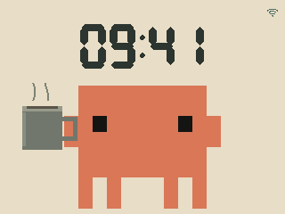</td>
    <td align="center" width="33%"><strong>Read a book</strong> <code>reading</code> 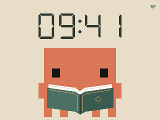</td>
  </tr>
  <tr>
    <td align="center" width="33%"><strong>Inspect the room</strong> <code>lens</code> 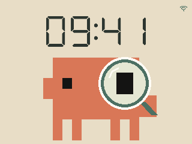</td>
    <td align="center" width="33%"><strong>Give the OK</strong> <code>ok</code> 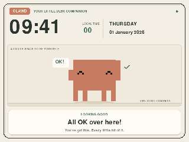</td>
    <td align="center" width="33%"><strong>Startle &amp; run</strong> <code>scared</code> 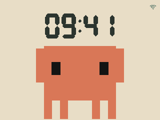</td>
  </tr>
  <tr>
    <td align="center" width="33%"><strong>Ring &amp; vibrate</strong> <code>phone_ringing</code> 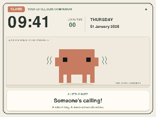</td>
    <td align="center" width="33%"><strong>Wear sunglasses</strong> <code>sunglasses</code> 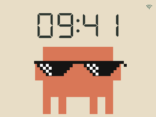</td>
    <td align="center" width="33%"><strong>Deal with it.</strong> <code>deal_with_it</code> 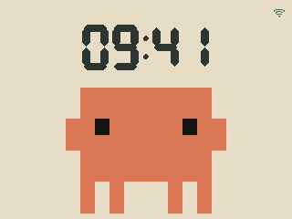</td>
  </tr>
  <tr>
    <td align="center" width="33%"><strong>Come closer</strong> <code>closeup</code> 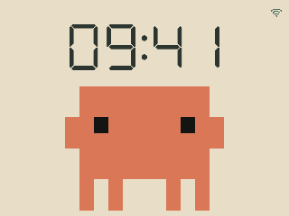</td>
    <td align="center" width="33%"><strong>Heart eyes</strong> <code>heart_eyes</code> 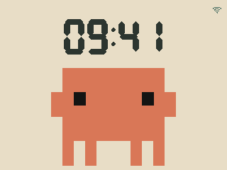</td>
    <td align="center" width="33%"><strong>Wave Poland&#x27;s flag</strong> <code>flag_pl</code> 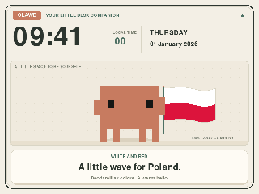</td>
  </tr>
  <tr>
    <td align="center" width="33%"><strong>AWS flag</strong> <code>flag_aws</code> 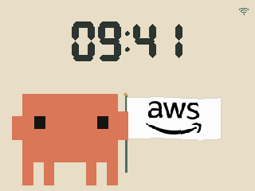</td>
    <td align="center" width="33%"><strong>ShipStation flag</strong> <code>flag_shipstation</code> </td>
    <td align="center" width="33%"><strong>Stamps.com flag</strong> <code>flag_stamps</code> 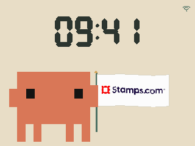</td>
  </tr>
  <tr>
    <td align="center" width="33%"><strong>Cloud Engineering</strong> <code>cloud_engineering</code> 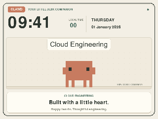</td>
    <td aria-hidden="true"></td>
    <td aria-hidden="true"></td>
  </tr>
</table>

## From claude.dev · gestures & focus

<table>
  <tr>
    <td align="center" width="33%"><strong>Look around</strong> <code>looking</code> 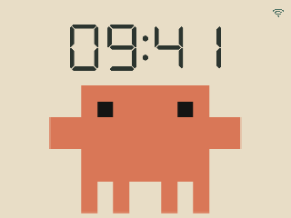</td>
    <td align="center" width="33%"><strong>Go for a walk</strong> <code>walking</code> 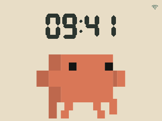</td>
    <td align="center" width="33%"><strong>Think</strong> <code>thinking</code> 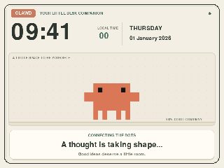</td>
  </tr>
  <tr>
    <td align="center" width="33%"><strong>Turn around</strong> <code>turning</code> 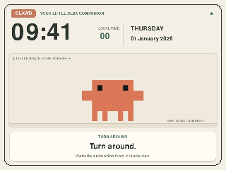</td>
    <td align="center" width="33%"><strong>Laptop time</strong> <code>laptop</code> 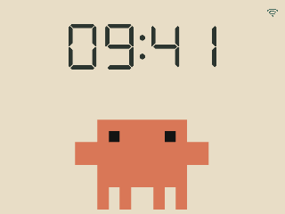</td>
    <td align="center" width="33%"><strong>Check the phone</strong> <code>phone</code> 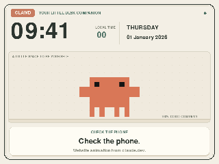</td>
  </tr>
  <tr>
    <td align="center" width="33%"><strong>Desktop time</strong> <code>desktop</code> 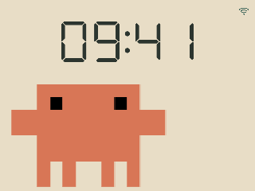</td>
    <td align="center" width="33%"><strong>Take notes</strong> <code>notebook</code> 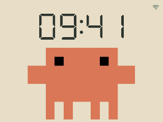</td>
    <td align="center" width="33%"><strong>Headphones on</strong> <code>headphones</code> 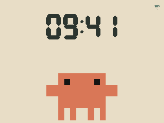</td>
  </tr>
  <tr>
    <td align="center" width="33%"><strong>Check the watch</strong> <code>watch</code> 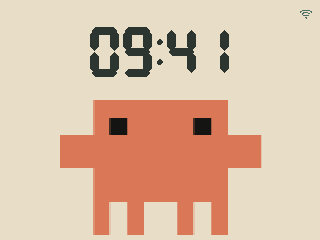</td>
    <td align="center" width="33%"><strong>Take a nap</strong> <code>sleeping</code> 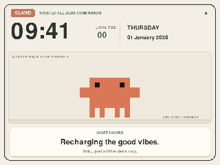</td>
    <td align="center" width="33%"><strong>A bright idea</strong> <code>lightbulb</code> 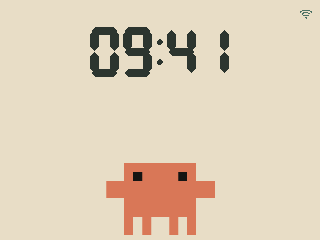</td>
  </tr>
  <tr>
    <td align="center" width="33%"><strong>Make a spark</strong> <code>spark</code> 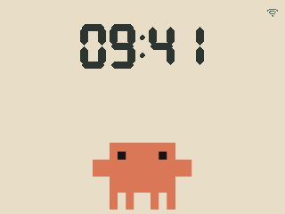</td>
    <td aria-hidden="true"></td>
    <td aria-hidden="true"></td>
  </tr>
</table>

## From claude.dev · hobbies & outdoors

<table>
  <tr>
    <td align="center" width="33%"><strong>Sway along</strong> <code>swaying</code> </td>
    <td align="center" width="33%"><strong>Juggle</strong> <code>juggling</code> </td>
    <td align="center" width="33%"><strong>Hula hoop</strong> <code>hula_hoop</code> 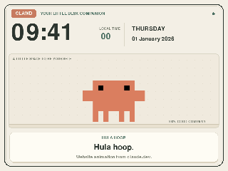</td>
  </tr>
  <tr>
    <td align="center" width="33%"><strong>Blow a bubble</strong> <code>bubble</code> 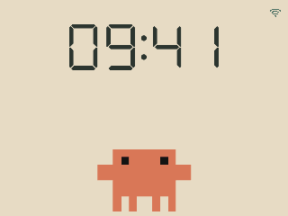</td>
    <td align="center" width="33%"><strong>Go fishing</strong> <code>fishing</code> 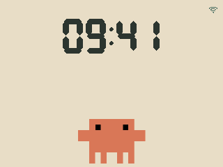</td>
    <td align="center" width="33%"><strong>Water a plant</strong> <code>watering</code> 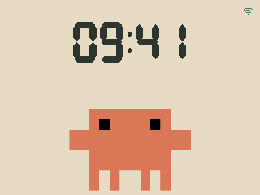</td>
  </tr>
  <tr>
    <td align="center" width="33%"><strong>Pick berries</strong> <code>berry_picking</code> 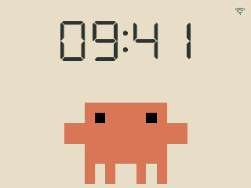</td>
    <td align="center" width="33%"><strong>Bloom</strong> <code>blooming</code> 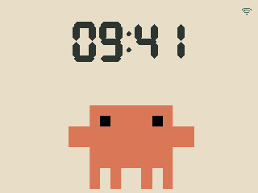</td>
    <td align="center" width="33%"><strong>Make a rainbow</strong> <code>rainbow</code> 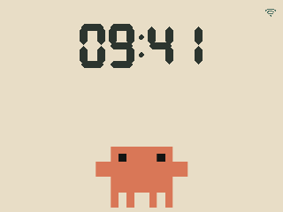</td>
  </tr>
  <tr>
    <td align="center" width="33%"><strong>A rose for you</strong> <code>rose</code> 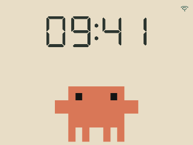</td>
    <td align="center" width="33%"><strong>Send a heart</strong> <code>heart</code> 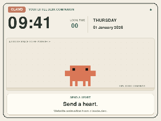</td>
    <td align="center" width="33%"><strong>Fly a kite</strong> <code>kite</code> 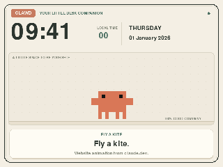</td>
  </tr>
  <tr>
    <td align="center" width="33%"><strong>Arcade break</strong> <code>arcade</code> 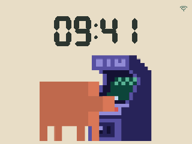</td>
    <td aria-hidden="true"></td>
    <td aria-hidden="true"></td>
  </tr>
</table>

## Finished

<table>
  <tr>
    <td align="center" width="33%"><strong>Header wave</strong> <code>wave</code> 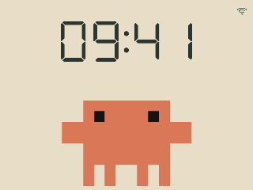</td>
    <td align="center" width="33%"><strong>Jump</strong> <code>bounce</code> 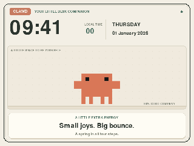</td>
    <td align="center" width="33%"><strong>Dance</strong> <code>dance</code> </td>
  </tr>
  <tr>
    <td align="center" width="33%"><strong>Happy dance</strong> <code>dancing_happy</code> 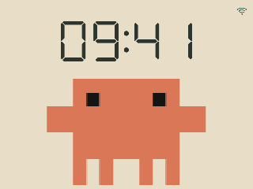</td>
    <td align="center" width="33%"><strong>Happy jumps</strong> <code>jumping_happy</code> 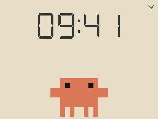</td>
    <td align="center" width="33%"><strong>Breakdance</strong> <code>breakdancing</code> 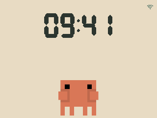</td>
  </tr>
  <tr>
    <td align="center" width="33%"><strong>Confetti</strong> <code>confetti</code> 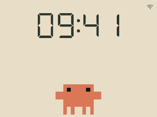</td>
    <td align="center" width="33%"><strong>Happy confetti</strong> <code>confetti_happy</code> 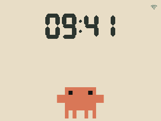</td>
    <td align="center" width="33%"><strong>Get excited</strong> <code>excited</code> 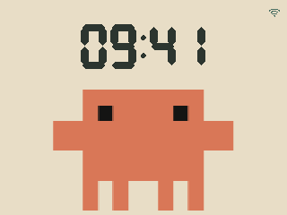</td>
  </tr>
  <tr>
    <td align="center" width="33%"><strong>Float in the pool</strong> <code>pool</code> </td>
    <td align="center" width="33%"><strong>Meditate</strong> <code>meditating</code> </td>
    <td aria-hidden="true"></td>
  </tr>
</table>

## From claude.dev · pixel adventures

<table>
  <tr>
    <td align="center" width="33%"><strong>Pixel stroll</strong> <code>pixel_walk</code> </td>
    <td align="center" width="33%"><strong>Skateboard</strong> <code>skate</code> </td>
    <td align="center" width="33%"><strong>Take a drive</strong> <code>car</code> </td>
  </tr>
  <tr>
    <td align="center" width="33%"><strong>Ride a scooter</strong> <code>scooter</code> </td>
    <td align="center" width="33%"><strong>Ride a bike</strong> <code>bike</code> </td>
    <td align="center" width="33%"><strong>Float in space</strong> <code>astronaut</code> </td>
  </tr>
</table>

## Easter Eggs

<table>
  <tr>
    <td align="center" width="33%"><strong>Windows blue screen</strong> <code>windows_bsod</code> </td>
    <td align="center" width="33%"><strong>Windows shutdown</strong> <code>windows_shutdown</code> </td>
    <td aria-hidden="true"></td>
  </tr>
</table>
<!-- END ANIMATION GALLERY -->

To rebuild the GIFs and these grouped tables, see [Regenerating the gallery](artwork.md#regenerating-the-gallery).
